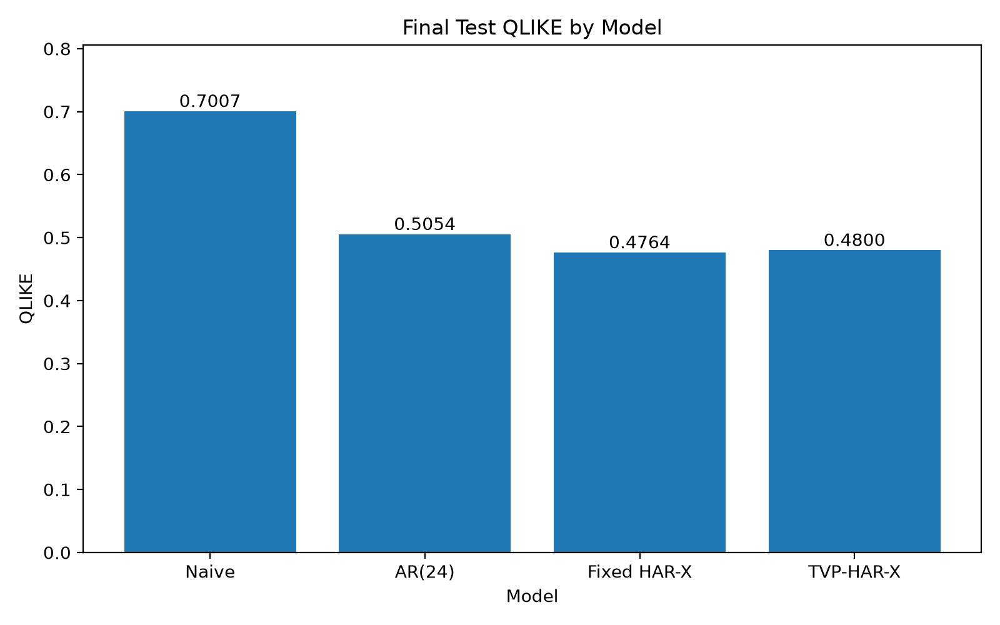

# One-Hour-Ahead Bitcoin Volatility Forecasting

**Multi-horizon realized volatility, market activity, and time-varying HAR-X models**

An empirical forecasting study of hourly Bitcoin realized variance using Binance BTCUSDT USD-margined perpetual futures data (January 2022–December 2025). The project compares persistence, AR(24), fixed-parameter HAR-X, and time-varying-parameter HAR-X (TVP-HAR-X) estimated as a state-space model with a Kalman filter.

This study was completed as the final course project for **CS6050L1: Time Series Analysis**, a graduate-level course at **The University of Tokyo**, in July 2026. The full methodological discussion, diagnostics, limitations, and references are available in [the report](report/main.pdf).

## Main findings

- **Multi-horizon volatility and market activity improve on a 24-lag AR benchmark.** Fixed HAR-X reduces 2025 test QLIKE by **5.75%** relative to AR(24).
- **The preferred model depends on the loss function.** TVP-HAR-X has the lowest test MAE and RMSE on the log-variance scale, while Fixed HAR-X has the lowest QLIKE on the variance scale.
- **Trading activity is the clearest additional HAR-X predictor.** Downside semivariance and the aggressive-buying proxy are not statistically significant in the fixed HAR-X estimation reported in the paper.

### Final out-of-sample results (2025)

All four models are evaluated on the same **8,422** valid test forecast timestamps. Lower loss is better.

| Model | MAE (log RV) ↓ | RMSE (log RV) ↓ | QLIKE ↓ |
| --- | ---: | ---: | ---: |
| Persistence | 0.7021 | 0.9101 | 0.7007 |
| AR(24) | 0.6133 | 0.7997 | 0.5054 |
| **Fixed HAR-X** | 0.5980 | 0.7807 | **0.4764** |
| **TVP-HAR-X** | **0.5901** | **0.7734** | 0.4800 |



The difference between the two HAR-X specifications is modest. TVP-HAR-X improves MAE by approximately 1.33% and squared-error loss by 1.87% relative to Fixed HAR-X; it does **not** improve the pre-specified primary QLIKE loss on the final test set. The corresponding one-sided HAC(24) test does not establish a QLIKE advantage for TVP-HAR-X.

## Data and forecasting design

- **Instrument:** Binance BTCUSDT USD-margined perpetual futures, five-minute candlesticks.
- **Sample:** 2022-01-01 to 2025-12-31 (UTC), 48 monthly files / 420,768 five-minute records before model filtering.
- **Target:** next-hour log realized variance, where hourly realized variance sums the squared five-minute log returns completed during the hour.
- **Volatility predictors:** current-hour, 6-hour, 24-hour, and 168-hour log-realized-variance components.
- **Additional predictors:** transformed downside realized semivariance, log(1 + hourly trade count), and a taker-buy-volume imbalance proxy.
- **Split:** 2022–2023 train; 2024 validation; 2025 held-out test.
- **Evaluation:** MAE, RMSE (both on log realized variance), and QLIKE (variance scale); predictive-loss comparisons with HAC(24) standard errors.

Feature construction maintains an hourly calendar, including gaps; scaling is learned from training data. The TVP model updates its latent coefficients sequentially. Details of how missing values and forecast timestamps are handled appear in the report.

## Methods

| Model | Specification |
| --- | --- |
| Persistence | Predict the next hour's log realized variance using the latest observed value. |
| AR(24) | OLS autoregression with 24 lags, selected using validation QLIKE from AR(1)–AR(24). |
| Fixed HAR-X | OLS model with seven standardized volatility/activity predictors. |
| TVP-HAR-X | Same seven predictors, with time-varying coefficients in a Gaussian state-space model estimated using the Kalman filter. |

## Repository structure

```text
.
├── README.md
├── environment.yml
├── requirements.txt
├── scripts/
│   └── run_pipeline.sh            # Full data-to-results workflow
├── src/
│   ├── download_full_data.py      # Official Binance archive download + checksum verification
│   ├── build_*.py                 # Data preparation and feature construction
│   ├── evaluate_naive_baseline.py
│   ├── run_complete_ar_analysis.py
│   ├── run_fixed_harx_analysis.py
│   ├── run_tvp_harx_analysis.py
│   ├── run_final_test_evaluation.py
│   └── create_final_report_outputs.py
├── outputs/
│   ├── tables/                   # Summary metrics, parameters, and diagnostics
│   ├── figures/                  # Figures from the empirical study
│   ├── predictions/              # Saved model-level prediction artifacts
│   └── states/                   # Saved time-varying coefficient paths
└── report/
    ├── main.pdf                  # Full paper
    ├── main.tex, references.bib
    └── sections/                 # LaTeX source
```

The `src/inspect_*.py` utilities are supplementary data-quality and exploratory diagnostic scripts. The core pipeline does not require running them.

## Reproduce the analysis

### 1. Create a Python environment

Python **3.11** was used for the study. Either create the Conda environment referenced in the report:

```bash
conda env create -f environment.yml
conda activate btc-volatility
```

Or use a Python 3.11 virtual environment:

```bash
python3.11 -m venv .venv
source .venv/bin/activate
python -m pip install -r requirements.txt
```

### 2. Download the input data and run all stages

From the repository root:

```bash
bash scripts/run_pipeline.sh
```

This script runs the data acquisition, cleaning, feature construction, development-sample fitting, locked 2025 evaluation, and plot-generation commands **in order**. It first downloads the 48 monthly public Binance archives (and checks their SHA-256 checksums), so the original market data are **not included** in this repository. Depending on network, hardware, and optimization settings, the full run may take considerable time.

You can also run stages individually. The final analysis sequence, **after data preparation**, is:

```bash
python src/evaluate_naive_baseline.py
python src/run_complete_ar_analysis.py
python src/run_fixed_harx_analysis.py
python src/run_tvp_harx_analysis.py
python src/run_final_test_evaluation.py
python src/create_final_report_outputs.py
```

### 3. Review generated results

- Primary results: `outputs/tables/final_test_model_metrics.csv`
- Final model comparison: `outputs/tables/final_test_model_comparison.csv`
- HAC predictive-loss tests: `outputs/tables/final_test_hac_loss_differential_tests.csv`
- Figures: `outputs/figures/`
- Complete explanation: [`report/main.pdf`](report/main.pdf)

The repository contains the original saved outputs from the completed study. **The archive-cleanup and documentation changes have been checked, but the full end-to-end pipeline has not been rerun on a freshly downloaded dataset during GitHub preparation.** The raw market data must be fetched to independently reproduce all outputs.

## Scope and limitations

The results apply to a single futures contract, exchange, and one-hour forecast horizon. The HAR-X variables use aggregated candlestick fields rather than full order-book microstructure. TVP coefficients represent predictive associations, not causal effects. Converting a predicted log variance via exponentiation is not, in general, a bias-corrected conditional mean variance forecast; see the discussion section in the report.

## Data provenance

Market data are obtained from the public [Binance Public Data repository](https://github.com/binance/binance-public-data) using scripts included here. Check the upstream source's applicable terms before redistributing the downloaded files.
